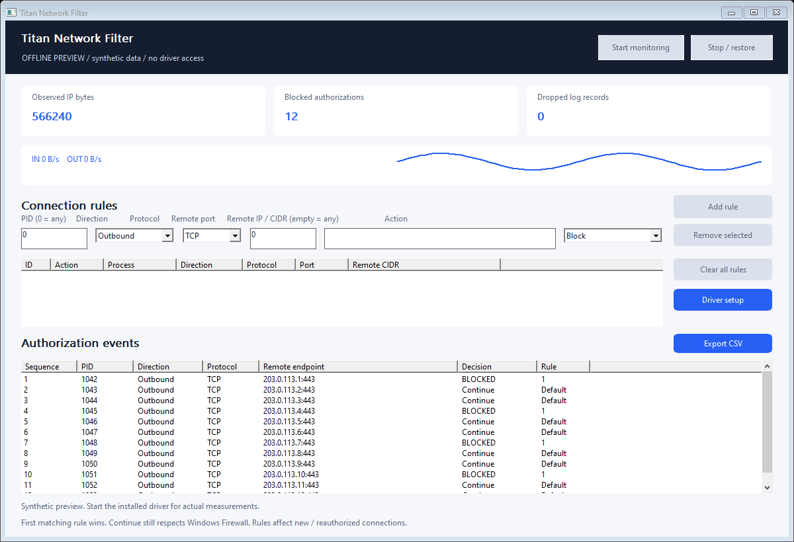

# Titan Network Filter

**Windows kernel network filter driver, native C++ SDK and desktop policy inspector.**

<!-- full-version-contact:start -->
> [!IMPORTANT]
> **Full version and commercial licensing**
>
> **Discord username: `titancsa`**
>
> Open Discord, choose **Friends > Add Friend**, enter **`titancsa`**, then send a direct message. Mention **Titan Network Filter** and ask about the **full / production version, commercial use or OEM redistribution**.
>
> Include your intended use and deployment size to discuss pricing, availability and the appropriate licensing / access instructions.
<!-- full-version-contact:end -->

Control new inbound and outbound connections on a local Windows PC. Inspect the
process, addresses, ports, protocol and exact rule ID behind each observed policy
decision, alongside live IP byte and buffer counts.



**Microsoft-signed evaluation bundle for Windows x64.** Download the application,
SDK, examples and self-contained UI/console installers together. Windows 10 2004+
and Windows 11 are build targets; see
[validation](docs/VALIDATION.md) for the tests actually performed and their limits.

## What you can do

| Feature | Behavior |
|---|---|
| Filter connections | IPv4 / IPv6; inbound / outbound; TCP, UDP or another IP protocol |
| Define rules | Current process ID, local/remote port ranges, remote IP/CIDR, direction and protocol |
| Control priority | Up to 64 ordered rules; first match wins; atomic policy replacement |
| Block or continue | Blocking is decided inside the ALE kernel callback; Continue leaves other Windows filters in control |
| Analyze decisions | Bounded event log with PID availability, QPC timestamp, policy generation and matching rule ID |
| Observe traffic volume | IP-layer byte/buffer counts and live observed rates, separately for inbound/outbound |
| Integrate | Two files, `SDK/NetworkFilter.cpp` and `SDK/NetworkFilter.h`, with RAII session cleanup |
| Export | Explicit CSV export of the displayed event metadata; no automatic upload |

The program starts inactive. Start monitoring initially allows traffic to continue
under Windows policy. Add rules from the interface or SDK. Stop or close the app
to remove its rules. A client crash also releases its dynamic WFP session and the
driver handle. This recovery behavior is intentional: this preview is a local
integration tool, not a tamper-resistant enterprise firewall or boot-time policy.

## Install and run

1. Download the complete Windows x64 ZIP from [Releases](https://github.com/titanfyre/Titan-Network-Filter/releases).
2. Extract the ZIP. For an optional offline tour, use `TitanNetworkFilter.exe --preview`;
   the labelled synthetic interface does not open the driver.
3. Run `NetworkFilterSetup.exe`, choose
   **Install / reinstall**, and restart only if Windows requests it. Console
   deployment uses `NetworkFilterSetupConsole.exe /install` or `/uninstall`.
   Installers validate the exact driver identity, Microsoft catalog signature and
   INF/SYS catalog membership. Source-only installer builds have no payload.
4. Run `TitanNetworkFilter.exe` as administrator and choose **Start monitoring**.
   Add the least broad rule needed. PID and port `0` mean any; empty CIDR means
   any remote address. Use **Continue** before a broader block for an exception.
5. **Clear all rules** removes the policy while keeping observation active.
   **Stop / restore** closes the session. Uninstall removes only this driver's node.

For a local console monitor: `NetworkFilterCLI.exe --monitor 30`.
This explicitly observes for 30 seconds without installing blocking rules.

## Minimal C++ integration

Compile `NetworkFilter.cpp` with your program. Link `setupapi`, `fwpuclnt`,
`ws2_32` and `rpcrt4`. Own a Session on one thread; separate threads must not call
the same Session concurrently.

```cpp
#include "NetworkFilter.h"
#include <windows.h>

NetworkFilter::Session network;
network.Start();
network.SetRules({NetworkFilter::Rule(
    1, NF_ACTION_BLOCK, 17, 9000, L"", GetCurrentProcessId())});
// Only this process's new outbound UDP authorizations to port 9000 are blocked.
auto decisions = network.Read();
auto statistics = network.Status();
network.SetRules({}); // Clear policy. Scope exit also stops the whole session.
```

`Rule(id, action, protocol, remotePort, remoteCidr, pid, direction)` constructs a
validated rule. To set local ports, port ranges or other fields, edit the returned
`NF_RULE` before `SetRules()`. Rule IDs must be nonzero and unique. Protocol `6`
is TCP, `17` is UDP, `0` is any; ports require TCP or UDP. `NF_INBOUND` is `1`,
`NF_OUTBOUND` is `2`, and direction `0` is both. `NF_ACTION_CONTINUE` is `0` and
`NF_ACTION_BLOCK` is `1`. Invalid inputs throw an English exception with a stage
and Windows error code where applicable. Failure to start does not leave a policy.

`Read()` returns at most 64 authorization records without waiting for traffic.
Drain it regularly; the bounded 2,048-record driver ring reports overwritten logs
through `Status().Dropped`. Log overload does not queue or drop network traffic.
The UI retains 500 records. Application paths are omitted unless `Start(true)` is
explicitly requested. Address/process metadata can still be sensitive.

## Measurement and policy boundaries

Rules apply at ALE authorization and reauthorization. Updating a rule does not
promise to disconnect every previously authorized TCP/UDP flow immediately.
Create a new connection to test a changed rule. Process IDs are current Windows
PIDs and can be reused: they are not durable application identities.

IP counters describe WFP observations, not Ethernet wire frames, billable traffic
or application goodput. Offloads, fragmentation, IPsec, loopback and filtering
position affect counts. Inbound IP header bytes are added when WFP supplies the
header length. Rates reflect the sampling window. A Continue event does not
prove delivery: another filter, routing or the remote peer can still reject it.
Higher-priority filters can also prevent this driver's callback from running.

There is no TLS decryption, browser password capture, payload logging, arbitrary
kernel execution, packet rewriting/injection, DNS-name policy, bandwidth shaping
or remote management in this version. Encryption remains intact. Windows Firewall
stays enabled. Network decisions never wait for the UI, a server, or a user-mode
packet round trip. The 250 ms UI refresh affects display only.

Simple static port/IP blocking alone does not require a custom driver: Windows
already provides WFP management APIs. This project's private callout combines
bounded runtime rule evaluation and attributed decisions with IP accounting for
native integrations. It does not claim to be the only way to implement filtering.

## Build

Visual Studio 2022 Desktop C++, CMake 3.20+, Windows SDK, x64:

```powershell
.\Build.ps1
.\Build.ps1 -Asan
# Optional: build self-contained installers using the signed opaque package:
.\Build.ps1 -DriverPackageDirectory C:\Signed\TitanNetworkFilter
```

Outputs: `obj/Build/bin/Release`. Offline tests do not open the driver, modify WFP
or capture traffic. `NetworkFilterCLI --self-test` is a separate explicit live
test for a disposable VM with the matching driver installed.

## Commercial integration

Application, SDK and example sources: [MIT](LICENSE). Kernel implementation stays
private. Driver binary evaluation and production redistribution are separate;
this evaluation build has no trial timer or online activation enforcement. See
`BINARY-LICENSE.txt` in the download for the separate driver evaluation terms.

For **OEM redistribution, a separately named driver, product integration, traffic
diagnostics or ongoing compatibility/support**, add **`titancsa` on Discord**.
Discuss your application and deployment volume for a scoped quote. Purchasing a
Microsoft signature alone is not the product, an endorsement, WHQL certification
or proof that every Windows configuration has been qualified.

Use only on systems and traffic you are authorized to administer. The project is
intended for lawful testing, diagnostics and software integration. You remain
responsible for your use; the applicable licenses describe the software's terms.

Technical references: [WFP callout design](https://learn.microsoft.com/en-us/windows-hardware/drivers/network/callout-driver-programming-considerations),
[ALE authorization](https://learn.microsoft.com/en-us/windows/win32/fwp/application-layer-enforcement--ale-),
[packet buffers and offsets](https://learn.microsoft.com/en-us/windows-hardware/drivers/network/packet-indication-format).
